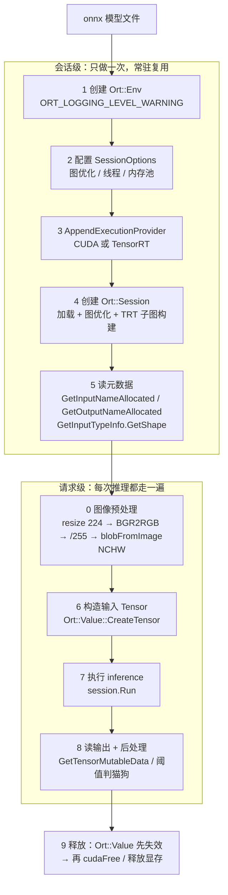

# ONNX Runtime 模型推理标准流程

> 本文基于本仓库源码静态阅读整理，覆盖 `main.cpp`、`relux.h/.cc`、`onnx_register.cc`、`CMakeLists.txt`。
> 运行时：**onnxruntime-gpu 1.20.1**（`E:/onnx_run_time/onnxruntime_gpu_1201`，见其 `VERSION_NUMBER`），
> 配套 **CUDA 12.x + cuDNN 9.x + TensorRT 10.x**（由 `lib/` 下 `cudart64_12.dll`、`cudnn64_9.dll`、`nvinfer_10.dll` 佐证）。
> 图像侧使用 **OpenCV**，外壳是 **Qt6 Quick** 工程（QML 目前只是空窗口，推理入口在 `main()`）。

---

## 1. 工程速览

| 文件 | 作用 | 关键位置 |
| --- | --- | --- |
| `main.cpp` | 全部推理逻辑：预处理、Session 配置、CUDA/TensorRT 两条 EP 路径、Run、后处理 | `main.cpp:14`、`main.cpp:33`、`main.cpp:188`、`main.cpp:315` |
| `Main.qml` | Qt Quick 空窗口，尚未参与推理交互 | `Main.qml:1` |
| `relux.h` | 自定义算子 `ReluX` 的 **Kernel** 与 **Op 描述类** 声明 | `relux.h:71`、`relux.h:83` |
| `relux.cc` | `KernelRelu::Compute` 实现（逐元素 `max(0,x)`） | `relux.cc:32` |
| `onnx_register.cc` | 自定义算子 DLL 导出入口 `RegisterCustomOps` | `onnx_register.cc:55` |
| `CMakeLists.txt` | 链接 `onnxruntime` / OpenCV / cudart，`POST_BUILD` 拷贝 ORT provider dll | `CMakeLists.txt:87`、`CMakeLists.txt:104` |
| `onnx/cat_dog_model_sim.onnx` | 待推理模型（由 `cat_dog_full_model.pt` 导出） | — |
| `onnx/trtexec` | TensorRT 官方命令行工具，可脱离 ORT 单独验证 engine | — |
| `cache/*.engine` | TRT EP 生成的 engine 缓存（文件名含 `fp16_sm86`） | — |
| `build/**/optimized_model.onnx` | `SetOptimizedModelFilePath` 落盘的图优化结果 | — |

模型契约（由代码反推，务必用 `netron` 或 `session.GetInputTypeInfo` 复核）：

- 输入：`float32`，NCHW = `[1, 3, 224, 224]`（`main.cpp:110`）
- 输出：单元素（`output[0]` 即"是狗"的概率/logit，`> 0.5` 判狗，`main.cpp:140-147`）
- 输入输出名不硬编码，运行时从 Session 元数据读取（`main.cpp:117-121`）

---

## 2. 心智模型：一次推理只有"五段"

理解 ONNX Runtime（下称 ORT）的推理，关键是分清哪些对象**一次创建、多次复用**，哪些对象**每次请求都要新建**：

| 段 | 内容 | 生命周期 | 开销 |
| --- | --- | --- | --- |
| ① 环境 | `Ort::Env` | 进程级，全局一份 | 极小 |
| ② 会话配置 | `Ort::SessionOptions` + `AppendExecutionProvider_*` | 会话语义，创建后可销毁 | EP 初始化（CUDA context、TRT engine 构建）可能是**秒级** |
| ③ 会话 | `Ort::Session`（加载 onnx、图优化、切分 TRT 子图） | 长驻，**必须复用** | 大 |
| ④ 输入 | 预处理后的 buffer → `Ort::Value` | 每次推理 | 与图大小相关 |
| ⑤ 输出 | `session.Run()` 返回的 `std::vector<Ort::Value>` → 后处理 | 每次推理 | 小 |

对应到 ORT 官方"标准七步"（Env → SessionOptions → Session → 取输入输出元数据 → 建 Tensor → Run → 取输出），本项目在此基础上补上了**预处理、后处理、资源释放**，共九步。下文按九步展开。

---

## 3. 流程图



纯文本版本（便于不支持 mermaid 的编辑器）：

```
[模型] → Env → SessionOptions(+EP) → Session → 输入/输出名+shape
                                                   ↓
[图像] → 预处理 → NCHW buffer → Ort::Value → Run → 输出 Ort::Value → 后处理 → 释放
```

---

## 4. 九步详解

### 步骤 0：预处理（与训练端逐项对齐）

源码位置：`main.cpp:14-30`（供 TRT 路径复用）、`main.cpp:36-51`（CUDA 路径内联）。

```cpp
cv::Mat src = cv::imread("...dog.4012.jpg");
if (src.empty()) return;                                   // 必须判空
cv::resize(src, src, cv::Size(224, 224));                   // ① 尺寸
cv::cvtColor(src, src, cv::COLOR_BGR2RGB);                  // ② 通道序
src.convertTo(src, CV_32FC3, 1.0 / 255.0);                  // ③ 归一化到 [0,1]
cv::Mat blob = cv::dnn::blobFromImage(src, 1.0, cv::Size(224,224),
                                      cv::Scalar(), false, false); // ④ 变 NCHW float32
std::memcpy(input_tensor.data(), blob.ptr<float>(),
            blob.total() * sizeof(float));                 // ⑤ 拷到连续线性缓冲
```

四个必须与训练端完全一致的点：

1. **尺寸**：`224×224` 直接 resize（非 `resize 256 + centerCrop 224`）。训练端若用 CenterCrop，会引入分布差异。
2. **颜色**：OpenCV 读入是 BGR，模型多为 RGB → `cvtColor` 转 RGB 后，`blobFromImage` 的 `swapRB` 必须传 **`false`**，否则二次交换。
3. **归一化**：`convertTo` 已做 `/255`，所以 `blobFromImage(..., scalefactor=1.0, ...)`。**若这里再传 `1/255` 就会双重缩放**。且 `mean = cv::Scalar()` 表示不减均值；若训练端用了 `Normalize(mean=[0.485,0.456,0.406], std=[0.229,0.224,0.225])`，C++ 端必须补上 `(x-mean)/std`（`blobFromImage` 只支持减 mean，不支持除 std，通常自己循环）。
4. **布局**：`blobFromImage` 输出 `1×3×H×W`（NCHW）的 `CV_32F` 连续内存，元素数 = `1*3*224*224 = 150528`。

> 结论：预处理是"离线精度"与"在线结果"不对齐的头号来源。判据很简单——用同一张图分别跑 Python 端与 C++ 端，比对输出值，差异应在 1e-4 量级内。

### 步骤 1：创建 `Ort::Env`

源码：`main.cpp:55`（CUDA 路径）、`main.cpp:189`（TRT 路径）。

```cpp
Ort::Env env(ORT_LOGGING_LEVEL_WARNING, "QT");   // 级别, 日志标签(自定义, 便于过滤)
```

- `Env` 是**进程级**对象，管理日志与线程池，`Session` 必须先有 `Env`。
- 建议全进程只建一个 `Env`（可放在 `main` 或单例里），不要每次推理新建。
- 级别：`VERBOSE / INFO / WARNING / ERROR / FATAL`。调试 EP 加载问题时可临时调到 `INFO`。
- 额外能力（本项目未用）：`env.RegisterTelemetryEp`、`env.CreateThreadingOptions()` 自定义线程亲和性。

### 步骤 2+3：配置 `SessionOptions` 并挂载 Execution Provider

这部分是"性能与硬件"的全部开关，源码分两处：CUDA 版 `main.cpp:56-99`，TensorRT 版 `main.cpp:191-220`。通用项：

| 配置 | 代码 | 说明 |
| --- | --- | --- |
| 算子内并行 | `SetIntraOpNumThreads(2)` | 单个算子内部的线程数；只影响 **CPU EP** |
| 算子间并行 | `SetInterOpNumThreads(2)` | 独立子图并发执行；同样主要影响 CPU |
| 图优化 | `SetGraphOptimizationLevel(ORT_ENABLE_ALL)` | 基础 + 扩展 + 布局优化，默认推荐 |
| 优化后模型落盘 | `SetOptimizedModelFilePath("optimized_model.onnx")` | 调试神器：能看到 ORT 究竟把图优化成什么；**在 Session 构造时写盘**，相对路径落在进程工作目录（所以出现在 `build/` 下） |
| CPU 内存池 | `EnableCpuMemArena()` | 默认开启，减少频繁分配 |
| 内存复用模式 | `DisableMemPattern()` | 本项目未用；某些自定义算子/动态 shape 场景需关掉 |

#### 3-A CUDA Execution Provider（`main.cpp:58-73`）

```cpp
OrtCUDAProviderOptions cuda_options{};
cuda_options.device_id = 0;                                   // 第几块 GPU
cuda_options.gpu_mem_limit = 4ULL * 1024 * 1024 * 1024;       // arena 上限 4GB
cuda_options.arena_extend_strategy = 0;                       // 0=kNextPowerOfTwo, 1=kSameAsRequested
cuda_options.cudnn_conv_algo_search = OrtCudnnConvAlgoSearchExhaustive; // 穷举卷积算法
session_option.AppendExecutionProvider_CUDA(cuda_options);
```

字段含义（对照 `include/onnxruntime_c_api.h:411`）：

- `device_id`：多卡时选卡；`CUDA_VISIBLE_DEVICES` 亦可控制。
- `gpu_mem_limit`：CUDA arena 可申请显存上限，超限会 `OOM`；小模型给 4GB 够用，显存富裕可设 `SIZE_MAX`。
- `arena_extend_strategy`：`0` 按 2 的幂扩张（碎片少、可能多占）；`1` 按实际请求扩张（省显存、易碎片）。
- `cudnn_conv_algo_search`：`Exhaustive` 首次会**逐算法 benchmark**，冷启动慢但稳态最快；服务化场景建议先跑热，或用 `Heuristic` 换启动速度。
- 其它可用但未设：`do_copy_in_default_stream`、`user_compute_stream`（与自有 CUDA 流/工程集成时）、`tunable_op_enable`（1.20 的 TunableOp 自动调优）。
- **API 版本提示**：1.20.1 中 `OrtCUDAProviderOptions`（V1 struct）与 `AppendExecutionProvider_CUDA` 属 legacy；新代码建议 `AppendExecutionProvider_CUDA_V2` + `UpdateCUDAProviderOptions`，或更简洁的字符串方式：`session_option.AppendExecutionProvider("CUDA", {{"device_id","0"},{"gpu_mem_limit","4294967296"}})`。

#### 3-B TensorRT Execution Provider（`main.cpp:195-226`）

```cpp
OrtTensorRTProviderOptions trt_options{};        // 注意 {}，C 结构体必须零初始化
trt_options.device_id = 0;
trt_options.trt_max_workspace_size = 4ULL * 1024 * 1024 * 1024;
trt_options.trt_fp16_enable = 1;
trt_options.trt_int8_enable = 0;
trt_options.trt_engine_cache_enable = 1;
trt_options.trt_engine_cache_path = "E:/dingjijizhang/onnx_pro/cache";
trt_options.trt_dla_enable = 0;                  // Jetson DLA，桌面卡恒为 0
session_opt.AppendExecutionProvider_TensorRT(trt_options);
```

字段含义（对照 `include/onnxruntime_c_api.h:587`）：

| 字段 | 作用 | 建议 |
| --- | --- | --- |
| `trt_max_workspace_size` | TRT builder 可用的显存临时空间 | 4GB 对分类网络足够；太小会导致某些层无法用 TRT |
| `trt_fp16_enable` | 启用 FP16 | 精度敏感任务先做数值对比（本项目 cache 文件名里就是 `fp16`） |
| `trt_int8_enable` | 启用 INT8 | 必须配 `trt_int8_calibration_table_name` 或 native 校准表，否则不可用 |
| `trt_engine_cache_enable/path` | engine 序列化缓存 | **生产必备**：否则每次启动都要重建 engine（数秒~数十秒） |
| `trt_max_partition_iterations` / `trt_min_subgraph_size` | TRT 子图切分粒度 | 想只让大块进 TRT 时调 `min_subgraph_size` |
| `trt_dump_subgraphs` | dump 切分出的子图 | 排查"哪些节点没进 TRT" |
| `trt_force_sequential_engine_build` | 串行构建 | 多 Session/多卡同时构建时避免显存峰值叠加 |

要点与坑：

1. **必须再追加 CUDA EP 兜底**。TRT EP 无法覆盖全部算子和全部输入形状，官方推荐注册顺序是 `TensorRT → CUDA`，让不支持的节点回退到 CUDA 执行。本项目只注册了 TRT EP（`main.cpp:220`），一旦模型里有 TRT 不支持的节点，构建/执行就会直接失败。标准写法：
   ```cpp
   session_opt.AppendExecutionProvider_TensorRT(trt_options);
   session_opt.AppendExecutionProvider_CUDA(cuda_options);   // fallback
   ```
2. **动态 shape 必须配 profile**：`trt_profile_min_shapes / opt_shapes / max_shapes`（字符串形如 `"input:1x3x224x224"`）。本项目模型是静态 `1×3×224×224`，所以没设也成立；换成动态 batch 就会报错。
3. **engine 缓存命中判据**包含 onnx 内容、TRT/cuDNN 版本、GPU 架构、精度开关。本仓库 `cache/` 下已有
   `TensorrtExecutionProvider_TRTKernel_graph_main_graph_4300316598989802040_0_0_fp16_sm86.engine`，
   说明：fp16 生效、GPU 为 **sm86**（RTX 30 系）、图被切分为 1 个 TRT 子图（`_0_0`）。同目录 `.profile` 是 TRT timing cache。
4. **首次构建 vs 后续启动**：首跑慢（构建 engine），之后命中 cache 秒开。这是 TRT 场景"冷启动"最容易被误判成 bug 的地方。
5. **旁路验证**：仓库自带 `onnx/trtexec`，可用
   `trtexec --onnx=onnx/cat_dog_model_sim.onnx --fp16 --shapes=...` 独立验证 engine 能否构建、各层耗时，从而把"ORT 配置问题"与"TRT 本身不支持"区分开。

### 步骤 4：创建 `Ort::Session`

源码：`main.cpp:102-108`。

```cpp
QString onnx_file_path = "E:/dingjijizhang/onnx_pro/onnx/cat_dog_model_sim.onnx";
#ifdef _WIN32
    std::wstring wpath = QFileInfo(onnx_file_path).absoluteFilePath().toStdWString();
    Ort::Session session(env, wpath.c_str(), session_option);   // Windows 走宽字符
#else
    std::string spath = model_path.toStdString();               // 注：此处变量名与上面不一致
    Ort::Session session(env, spath.c_str(), session_options);
#endif
```

- **路径编码**：Windows 版 ORT 的 `ORTCHAR_T = wchar_t`，所以必须 `toStdWString()`；用 `std::string` 遇到中文路径会失败。同时建议先 `QFileInfo::absoluteFilePath()` 转绝对路径，避免相对路径受工作目录影响。
- **构造期的工作**：解析 protobuf → 图优化 → EP 切分（CUDA kernel 注册 / TRT 子图构建）。**这是最重的一步**，因此 Session 必须常驻复用，绝不能"每推理一次 new 一个"。
- **生命周期**：`Env` 与 `SessionOptions` 的生命周期必须覆盖 `Session`。`Ort::Session` 可安全地在多线程中并发 `Run`（前提是各线程用各自的输入/输出 tensor）。
- **`Ort::Session` 不可拷贝**，需传递时用 `std::unique_ptr<Ort::Session>` / `std::shared_ptr`。

### 步骤 5：读取输入输出元数据

源码：`main.cpp:116-121`。

```cpp
Ort::AllocatorWithDefaultOptions allocator;
Ort::AllocatedStringPtr input_name_ptr  = session.GetInputNameAllocated(0, allocator);
Ort::AllocatedStringPtr output_name_ptr = session.GetOutputNameAllocated(0, allocator);

const char* input_names[]  = { input_name_ptr.get() };
const char* output_names[] = { output_name_ptr.get() };
```

- `*AllocatedStringPtr` 是 `unique_ptr<char, AllocatedFree>`，**离开作用域自动释放**；`Run` 只借用 `.get()`，所以这两个指针必须活到 `Run` 之后（本例在同一作用域内，安全）。
- 节点数用 `GetInputCount()` / `GetOutputCount()`；顺序即索引，**不要假设"0 号是图像、1 号是标签"**。
- 更稳妥的做法是从元数据推导 shape，而不是硬编码：
  ```cpp
  auto in_info   = session.GetInputTypeInfo(0).GetTensorTypeAndShapeInfo();
  auto in_shape  = in_info.GetShape();          // 动态维为 -1，需自行补齐
  auto elem_type = in_info.GetTensorElementType();
  auto out_shape = session.GetOutputTypeInfo(0).GetTensorTypeAndShapeInfo().GetShape();
  ```
  本项目 `main.cpp:110` 把 `{1,3,224,224}` 写死了——对静态模型可行，换成动态 shape 模型会直接 `INVALID_ARGUMENT`。

### 步骤 6：构造输入 `Ort::Value`

#### 6-A CPU 内存（CUDA EP 路径，`main.cpp:110-113`）

```cpp
std::vector<int64_t> shape = {1, 3, 224, 224};
Ort::MemoryInfo memory_info = Ort::MemoryInfo::CreateCpu(OrtArenaAllocator, OrtMemTypeDefault);
Ort::Value inputTensor = Ort::Value::CreateTensor<float>(
        memory_info,
        input_tensor.data(),        // 数据指针
        input_tensor.size(),        // 元素个数（不是字节数！）
        shape.data(), shape.size()); // shape + 维数
```

- **零拷贝**：`CreateTensor` 不复制数据，只持有指针。所以 `input_tensor`（`QVector<float>`）必须活到 `Run` 返回之后。若用临时 `std::vector` 并在 `Run` 前析构，就是典型的野指针。
- `element_count` 语义：这个 4 参数重载要求**元素个数**（`150528`），不是 `150528*4`。
- `MemoryInfo` 说明数据在哪种内存里：`"Cpu"`、`"Cuda"`、`"CudaPinned"` 等。CPU 输入配合 CUDA EP 时，ORT 会自动做 H2D 拷贝（隐含开销）。
- 元素类型：`CreateTensor<float>` 对应 `ONNX_TENSOR_ELEMENT_DATA_TYPE_FLOAT`；若模型输入是 `uint8`（很多量化模型），必须建 `uint8` tensor，否则类型检查失败。

#### 6-B GPU 显存（TensorRT 路径，`main.cpp:238-251`）

```cpp
Ort::MemoryInfo memory_info("Cuda", OrtAllocatorType::OrtArenaAllocator, 0, OrtMemTypeDefault);

float* gpu_input = nullptr;
cudaMalloc(&gpu_input, input_tensor.size() * sizeof(float));
cudaMemcpy(gpu_input, input_tensor.data(),
           input_tensor.size() * sizeof(float), cudaMemcpyHostToDevice);

Ort::Value inputTensor = Ort::Value::CreateTensor<float>(
        memory_info, gpu_input, input_tensor.size(), shape.data(), shape.size());
```

- `MemoryInfo("Cuda", ...)` 的第 3 个参数是 **device_id**，必须与 EP 的 `device_id` 一致。
- `cudaMemcpy` 是同步语义，返回即代表数据已在显存，可直接 `Run`；若改用 `cudaMemcpyAsync`，必须 `cudaStreamSynchronize` 后再 `Run`（或使用 `user_compute_stream` 把 ORT 与自有流对齐）。
- **释放顺序**：`Ort::Value`（释放句柄）→ `cudaFree(gpu_input)`。顺序反了就是 use-after-free。
- 这块显存**不属于 ORT arena**，ORT 不会替你释放。本源码没有 `cudaFree`（见第 9 节），属于泄漏。

### 步骤 7：执行推理 `session.Run`

源码：`main.cpp:123-130`（CUDA）、`main.cpp:266-273`（TRT）。

```cpp
auto output_tensors = session.Run(
        Ort::RunOptions{nullptr},   // 运行选项（可设日志级别、profile 开关）
        input_names,                // 输入名数组
        &inputTensor,               // 输入 Value 数组
        1,                          // 输入个数
        output_names,               // 输出名数组
        1);                         // 输出个数
```

- 返回 `std::vector<Ort::Value>`，**顺序与 `output_names` 一致**。
- 这 6 个参数是 C++ 封装的最小形态；完整重载还支持 `Ort::RunOptions` 配置（`SetRunLogVerbosityLevel`、`EnableProfiling`、`AddRunConfigEntry`）。
- **可以只取部分输出**：把 `output_names` 收窄到实际需要的节点，能显著减少计算与拷贝（中间层输出不要顺手全要）。
- **形状可变**：某些模型输出形状由输入推导，所以输出 shape 必须在 `Run` 之后从返回值读，不能提前假设。
- 性能观测：`RunOptions::EnableProfiling("profile.json")` 可在本进程内采样各算子耗时；与 `optimized_model.onnx` 配合使用，是定位"慢在哪一层"的标准手段。

### 步骤 8：读取输出 + 后处理

源码：`main.cpp:133-147`。

```cpp
float* output = output_tensors[0].GetTensorMutableData<float>();
size_t output_size = output_tensors[0].GetTensorTypeAndShapeInfo().GetElementCount();

float conf = output[0];
if (conf > 0.5) qDebug() << "当前是狗";
else            qDebug() << "当前是猫";
```

- 取值：只读用 `GetTensorData<T>()`，要写用 `GetTensorMutableData<T>()`；类型必须与模型输出元素类型一致（错用模板会得到垃圾数据且不报错）。
- 形状：`GetTensorTypeAndShapeInfo().GetShape()` 拿维度，`.GetElementCount()` 拿元素数。
- **后处理与模型的最后一层强耦合**，三种常见情况：
  - 模型已含 `Sigmoid`，输出单值 → 阈值比较（本项目）；
  - 模型输出 logits（无激活）→ 需自己 `sigmoid`/`softmax` 再比较，否则阈值 0.5 毫无意义；
  - 输出 `[1, 2]`（cat/dog 两类的 softmax）→ 取 `argmax`，而不是读 `[0]`。
- 读输出前建议断言 `output_size`，防止模型换版后越界读。

### 步骤 9：释放与异常处理

本源码的释放**基本靠 RAII**：`Ort::Env / SessionOptions / Session / Value / AllocatedStringPtr` 都是 RAII 包装，`detail::Base` 析构时调用对应的 `Release*`。因此：

- 正常路径不需要手动 `Release`；
- 但 `cudaMalloc` 出来的裸指针、`cv::Mat` 之外的裸 `new` **必须手动释放**；
- 顺序：先销毁 `Ort::Value` → 再 `cudaFree`；先销毁 `Session` → 再销毁 `Env`（成员声明顺序即析构逆序，写类时注意）。

异常处理模板（`main.cpp:93-99`、`main.cpp:151-157`）：

```cpp
try {
    // ORT 全部 C++ API 都可能抛 Ort::Exception
} catch (const Ort::Exception& e) {
    qDebug() << e.what() << " code=" << e.GetOrtErrorCode();   // GetOrtErrorCode() 可分支处理
} catch (const std::exception& e) {
    qDebug() << e.what();
}
```

常见异常与含义：

| `OrtErrorCode` / 消息关键片段 | 含义 |
| --- | --- |
| `INVALID_ARGUMENT : Invalid input name` | 输入名拼错，或模型有多个输入只喂了一个 |
| `INVALID_ARGUMENT : Got invalid dimensions` | shape 与元数据不符（最典型：batch/通道/HW 硬编码错） |
| `FAIL : Load model from ... failed` | 路径不存在/中文路径未用宽字符/onnx 损坏 |
| `NOT_IMPLEMENTED : Could not find an implementation for ...` | 该算子无可用内核 → EP 没挂上、opsets 过高、或自定义算子 domain 未注册 |
| `FAIL : CUDA error ... out of memory` | 显存不足，降 `gpu_mem_limit`/workspace 或减 batch |

---

## 5. 三套执行路径对照

| 维度 | 默认 CPU EP | CUDA EP（`main.cpp:33`） | TensorRT EP（`main.cpp:188`） |
| --- | --- | --- | --- |
| 注册方式 | 不注册即为 CPU | `AppendExecutionProvider_CUDA` | `AppendExecutionProvider_TensorRT`（建议再加 CUDA 兜底） |
| 输入内存 | CPU（`CreateCpu`） | CPU，ORT 内部 H2D | 显存（`MemoryInfo("Cuda")` + `cudaMalloc`） |
| 首跑开销 | 无 | CUDA context + cuDNN 算法 benchmark | **构建 engine，秒级** |
| 稳态性能 | 低 | 高 | 最高（FP16/INT8、层融合） |
| 算子覆盖 | 全 | 很全，未覆盖回退 CPU | **不全覆盖**，必须 CUDA 兜底 |
| 额外依赖 | 无 | cudart / cublas / cudnn | 再加 nvinfer 10.x、nvonnxparser |
| 适用场景 | 调试、小模型、CI | 通用 GPU 加速 | 固定 shape、极致吞吐/延迟 |

---

## 6. 自定义算子的标准流程（`ReluX`）

源码：`relux.h:71-106`、`relux.cc:32-49`、`onnx_register.cc:55-73`。

### 6.1 五步法

**第 1 步 · 实现 Kernel**：真正干活的函数，通过 `OrtKernelContext` 拿输入、申请输出。

```cpp
void KernelRelu::Compute(OrtKernelContext* context) {
    Ort::KernelContext ctx(context);
    auto input  = ctx.GetInput(0);                                   // 第 0 个输入
    const float* in = input.GetTensorData<float>();
    auto info  = input.GetTensorTypeAndShapeInfo();
    auto shape = info.GetShape();
    size_t count = info.GetElementCount();

    auto output = ctx.GetOutput(0, shape.data(), shape.size());      // 输出缓冲由 ORT 分配
    float* out  = output.GetTensorMutableData<float>();

    for (size_t i = 0; i < count; ++i) out[i] = in[i] > 0 ? in[i] : 0.f;
}
```

要点：输入输出都是 `Ort::Value`；输出**不要自己 `new`**，用 `GetOutput(index, dims, ndim)` 让 ORT 分配；`GetInputCount` / shape 必须在运行期读，不能写死。

**第 2 步 · 描述 Op**：继承 `Ort::CustomOpBase<TOp, TKernel, WithStatus>`。

```cpp
class ReluOption : public Ort::CustomOpBase<ReluOption, KernelRelu, false> {
    void* CreateKernel(const OrtApi& api, const OrtKernelInfo* info) const {
        return new KernelRelu(api, info);                            // 配套 delete 由基类 KernelDestroy 完成
    }
    const char* GetName() const { return "ReluX"; }                  // 必须与 onnx 节点的 op_type 一致
    const char* GetExecutionProviderType() const { return "CPUExecutionProvider"; }
    size_t GetInputTypeCount()  const { return 1; }
    ONNXTensorElementDataType GetInputType(size_t)  const { return ONNX_TENSOR_ELEMENT_DATA_TYPE_FLOAT; }
    size_t GetOutputTypeCount() const { return 1; }
    ONNXTensorElementDataType GetOutputType(size_t) const { return ONNX_TENSOR_ELEMENT_DATA_TYPE_FLOAT; }
};
```

模板第三个参数是 **`WithStatus`**（`onnxruntime_cxx_api.h:2295`）：

- `false`：Kernel 用 `void Compute(OrtKernelContext*)`，`CreateKernel` 返回 `void*`（本源码采用）；
- `true`：Kernel 用 `OrtStatusPtr ComputeV2(...)`，`CreateKernelV2` 返回 `OrtStatusPtr`，**能把错误码/信息上报给 ORT**。业务代码建议用 `true`，避免异常穿过 C ABI 边界（UB）。

`relux.h:6-57` 被注释掉的那段就是 `WithStatus=true` 的写法，可直接作为升级参考。

**第 3 步 · 建域 + 注册**：`onnx_register.cc:57-71`。

```cpp
const OrtApi* ort = api->GetApi(ORT_API_VERSION);

OrtCustomOpDomain* domain = nullptr;
OrtStatus* status = ort->CreateCustomOpDomain("custom", &domain);   // 域名字符串
if (status) return status;

status = ort->CustomOpDomain_Add(domain, &relu_op);
if (status) { ort->ReleaseCustomOpDomain(domain); return status; }

status = ort->AddCustomOpDomain(options, domain);                    // 挂到 SessionOptions
ort->ReleaseCustomOpDomain(domain);                                  // 域已交给 options，释放本地句柄
return status;
```

**第 4 步 · 导出入口**：`onnx_register.cc:55`。

```cpp
extern "C" __declspec(dllexport) OrtStatus* ORT_API_CALL
RegisterCustomOps(OrtSessionOptions* options, const OrtApiBase* api);
```

- 函数名 `RegisterCustomOps`、签名、`__declspec(dllexport)`（Windows）三者缺一不可；Linux 用 `__attribute__((visibility("default")))`。
- 必须 `extern "C"`，否则名字修饰导致 ORT 找不到符号。
- 用 `api->GetApi(ORT_API_VERSION)` 而不是硬编码版本号。

**第 5 步 · 在应用中挂载**（本项目**尚未接上**，`func_custsom_kernel` 是空函数，`main.cpp:304`）：

```cpp
// 方式一：加载 DLL（推荐，热插拔）
session_options.RegisterCustomOpsLibrary(L"relux.dll");

// 方式二：同进程直接挂域（需自己持有 domain 生命周期）
Ort::CustomOpDomain domain("custom");
domain.Add(&relu_op);
session_options.Add(domain);
```

### 6.2 三个"必须对上"

1. **域名对上**：模型节点的 `domain` 必须是 `"custom"`（本例），C++ 里 `CreateCustomOpDomain("custom")` 必须一致，且 onnx 图的 `opset_import` 要包含该域。
2. **EP 对上**：`GetExecutionProviderType()` 返回 `"CPUExecutionProvider"` 就意味着该节点只能跑在 CPU。若想跑在 CUDA，需要在 GPU 上实现并用 `"CUDAExecutionProvider"`，同时处理 `GetInputMemoryType`（指出哪些输入要求 CPU 内存）。
3. **类型对上**：`GetInputType/GetOutputType` 与实际 tensor 元素类型必须一致，否则运行期报类型校验错误。

> 注意：`CMakeLists.txt:37-55` 已经把 `relux.cc + onnx_register.cc` 编成独立的 `relux` SHARED 目标并链接 `onnxruntime`，也就是"自定义算子 DLL"已经能产出；同时这两个文件又被加入 `apponnx_pro` 可执行目标（`CMakeLists.txt:20-25`），属于"同一份代码进两个产物"的写法，方便调试，但正式发布建议只留 DLL 形态。

---

## 7. 构建与部署清单

`CMakeLists.txt` 的关键动作：

| 位置 | 动作 | 说明 |
| --- | --- | --- |
| `:5-9` | C++17、`ONNX_RUN_TIME_ROOT`、`OPENCV_DIR`、`CUDA_ROOT_DIR` | 三个绝对路径，换机必须改 |
| `:11` | `enable_language(CUDA)` | 因为 `main.cpp` 里直接调 `cudaMalloc/cudaMemcpy` |
| `:87-92` | 链接 `Qt6::Quick`、`onnxruntime`、`OpenCV_LIBS`、`cudart` | 用 `onnxruntime.lib` 导入库 |
| `:104-124` | POST_BUILD 拷贝 4 个 ORT dll | `onnxruntime.dll`、`providers_cuda/shared/tensorrt.dll` |
| `:130-136` | 按配置拷贝 `opencv_world460(d).dll` | Debug/Release 区分 |

**未自动拷贝但运行必需的依赖**（否则 `LoadLibrary` 失败 / `0xc0000135`）：

- CUDA：`cudart64_12.dll`、`cublas64_12.dll`、`cublasLt64_12.dll`、`cufft64_11.dll`
- cuDNN 9：`cudnn64_9.dll` 及 `cudnn_*64_9.dll` 系列
- TensorRT 10：`nvinfer_10.dll`、`nvinfer_plugin_10.dll`、`nvonnxparser_10.dll`、`nvinfer_builder_resource_10.dll` 等

两种做法任选：把 `E:/onnx_run_time/onnxruntime_gpu_1201/lib` 加入 `PATH`，或在 CMake 里再补一段 `POST_BUILD` 拷贝全部 dll。打包时用 `windeployqt` + 手动补 ORT/CUDA 依赖。

其它注意：

- **MSVC 运行时**：`onnxruntime.lib` 默认 `/MD`，工程也必须 `/MD`（不能 `/MT`）。
- **vcpkg/conan 混用**：`build/*/.qtc/package-manager/conan*.cmake` 是 Qt Creator 自动注入的，若打开会与本地手配 ORT 冲突，建议关掉。
- **CUDA 架构**：`CMAKE_CUDA_ARCHITECTURES` 未设会导致构建慢（编译所有架构）；可显式设 `86`。

---

## 8. 一页纸最小可复用模板

把上面的流程压成一个可复用类（CUDA EP，CPU 输入，单输入单输出）：

```cpp
// cat_dog_engine.h
#include <onnxruntime_cxx_api.h>
#include <opencv2/opencv.hpp>
#include <memory>
#include <string>
#include <vector>

class CatDogEngine {
public:
    explicit CatDogEngine(const std::wstring& model_path) {
        OrtCUDAProviderOptions cuda{};
        cuda.device_id = 0;
        cuda.gpu_mem_limit = 4ULL * 1024 * 1024 * 1024;
        cuda.arena_extend_strategy = 1;                              // 省显存
        cuda.cudnn_conv_algo_search = OrtCudnnConvAlgoSearchHeuristic; // 快启动

        opts_.SetIntraOpNumThreads(1);
        opts_.SetGraphOptimizationLevel(GraphOptimizationLevel::ORT_ENABLE_ALL);
        opts_.EnableCpuMemArena();
        opts_.AppendExecutionProvider_CUDA(cuda);

        session_ = std::make_unique<Ort::Session>(env_, model_path.c_str(), opts_);

        Ort::AllocatorWithDefaultOptions alloc;
        input_name_  = session_->GetInputNameAllocated(0, alloc).get();
        output_name_ = session_->GetOutputNameAllocated(0, alloc).get();

        auto info = session_->GetInputTypeInfo(0).GetTensorTypeAndShapeInfo();
        shape_ = info.GetShape();                                    // 从模型读，不写死
        buf_.resize(1 * 3 * 224 * 224);
    }

    // 返回"是狗"的分数
    float Infer(const cv::Mat& bgr) {
        Preprocess(bgr);
        Ort::MemoryInfo mem = Ort::MemoryInfo::CreateCpu(OrtArenaAllocator, OrtMemTypeDefault);
        Ort::Value in = Ort::Value::CreateTensor<float>(
            mem, buf_.data(), buf_.size(), shape_.data(), shape_.size());

        const char* in_names[]  = { input_name_.c_str() };
        const char* out_names[] = { output_name_.c_str() };
        auto outs = session_->Run(Ort::RunOptions{nullptr}, in_names, &in, 1, out_names, 1);

        const float* p = outs[0].GetTensorData<float>();
        return p[0];
    }

private:
    void Preprocess(const cv::Mat& src) {
        cv::Mat rgb, f32;
        cv::cvtColor(src, rgb, cv::COLOR_BGR2RGB);
        cv::resize(rgb, rgb, cv::Size(224, 224));
        rgb.convertTo(f32, CV_32FC3, 1.0 / 255.0);                   // 若训练端有 mean/std，这里补
        cv::Mat blob = cv::dnn::blobFromImage(f32, 1.0, cv::Size(224, 224),
                                             cv::Scalar(), false, false);
        std::memcpy(buf_.data(), blob.ptr<float>(), buf_.size() * sizeof(float));
    }

    Ort::Env            env_{ORT_LOGGING_LEVEL_WARNING, "cat_dog"};
    Ort::SessionOptions opts_;
    std::unique_ptr<Ort::Session> session_;
    std::string  input_name_, output_name_;
    std::vector<int64_t> shape_;
    std::vector<float>   buf_;
};
```

调用侧：

```cpp
int main() {
    try {
        CatDogEngine engine(L"E:/dingjijizhang/onnx_pro/onnx/cat_dog_model_sim.onnx");
        cv::Mat img = cv::imread("E:/dingjijizhang/onnx_pro/archive/test_set/test_set/dogs/dog.4012.jpg");
        if (img.empty()) return 1;
        float s = engine.Infer(img);
        std::printf("dog score=%.6f -> %s\n", s, s > 0.5f ? "dog" : "cat");
    } catch (const Ort::Exception& e) {
        std::fprintf(stderr, "ORT error: %s\n", e.what());
        return 1;
    }
    return 0;
}
```

---

## 9. 源码审查要点（可直接当 checklist）

| # | 位置 | 现象 | 影响 / 建议 |
| --- | --- | --- | --- |
| 1 | `main.cpp:246` | `cudaMalloc` 后没有 `cudaFree` | 每次推理泄漏 600KB；建议 `unique_ptr<float, decltype(&cudaFree)>` 或 `cudaFree` 收尾，且保证先销毁 `Ort::Value` |
| 2 | `main.cpp:220` | 只注册 TRT EP，未追加 CUDA EP | TRT 不支持的节点直接失败；应 `TRT → CUDA` 两级注册 |
| 3 | `main.cpp:57-99` | `try` 只包住 EP 配置，`catch` 后继续创建 Session | EP 挂载失败会被吞掉，静默退化为 CPU；建议把"配置 + 建会话 + 首次 Run"放进同一 `try`，失败即返回错误码 |
| 4 | `main.cpp:160-161` | 非 Windows 分支引用未定义的 `model_path` / `session_options` | Linux 下编译不过；应为同一变量名 |
| 5 | `main.cpp:139-141` | `dert`、`expected`、`ok` 定义后未参与判定，`ok` 恒为 `true` | 所谓"验证通过"是假的；应实现与参考输出的数值比对（`max_abs_diff < dert`） |
| 6 | `main.cpp:142-147` | 硬编码"读 `output[0]`，`>0.5` 判狗" | 模型换层（logits/softmax/多类）后逻辑静默错误；应按 `GetElementCount()` 分支处理 |
| 7 | `main.cpp:110` | shape 写死 `{1,3,224,224}` | 换动态 shape 模型必失败；应从 `GetInputTypeInfo` 读并可校验 |
| 8 | `main.cpp:42-47` | `convertTo(1/255)` 后再 `blobFromImage(scale=1.0, mean=0)` | 若训练端含 `Normalize(mean,std)`，此处缺均值方差 → 精度整体偏移（最易被忽略的坑） |
| 9 | `main.cpp:85-86` | 优化模型写到相对路径 `optimized_model.onnx` | 落盘位置随工作目录漂移；建议绝对路径，并注意该文件是**调试产物**，勿与原始模型混淆 |
| 10 | `main.cpp:76-79` | `intra/inter` 线程设为 2 | 纯 GPU 路径下影响极小；CPU 兜底节点多时才有意义，需 benchmark 而非拍脑袋 |
| 11 | `main.cpp:336-338` | `main` 末尾无 `return`，`int i=0;` 未使用 | 符合标准（`main` 掉尾等价 `return 0`），但会触发警告；应显式 `return 0` 并删掉无用变量 |
| 12 | `main.cpp:102,222` | 模型路径硬编码绝对路径 | 部署即失效；建议命令行参数/配置文件 + `QStandardPaths` |
| 13 | `main.cpp:304` | `func_custsom_kernel()` 为空 | 自定义算子 DLL 虽已编出，但会话从未挂载 → 含 `ReluX` 的模型会报 `NOT_IMPLEMENTED` |
| 14 | — | 每次推理都重建 Session 的写法风险 | 当前是单次调用尚可，接入 UI 循环调用时必须把 `Env/Session` 提到类成员 |
| 15 | `main.cpp:133-134` | 输出指针在用完后立即假设有效性 | `output_tensors` 是局部变量，离开作用域即释放；若把指针保存到外层就是悬垂指针 |

---

## 10. 术语表

| 术语 | 含义 |
| --- | --- |
| `Ort::Env` | 运行时环境，承载日志与线程池，进程内一份 |
| `Ort::SessionOptions` | 会话配置容器：图优化、线程、内存池、EP 列表 |
| `Ort::Session` | 加载后的模型实例，线程安全，可并发 `Run` |
| Execution Provider (EP) | 执行后端：`CPUExecutionProvider`、`CUDAExecutionProvider`、`TensorrtExecutionProvider` |
| `Ort::Value` | 类型擦除的 tensor/序列/映射容器，输入输出都用它 |
| `Ort::MemoryInfo` | 描述数据所在内存（`Cpu`/`Cuda`/`CudaPinned`）与分配器类型 |
| `Ort::AllocatedStringPtr` | ORT 分配、RAII 释放的字符串（用于输入/输出名） |
| `Ort::IoBinding` | 显式绑定输入输出到指定设备缓冲，省去隐式拷贝（本项目未使用，是下一步优化点） |
| `custom op domain` | 自定义算子命名空间，须与 onnx 节点的 `domain` 一致 |
| `optimized_model.onnx` | 图优化后的模型快照，仅用于观察/调优 |

---

## 11. 快速对照：从"源码调用"到"标准步骤"

```
main.cpp:320  Ort::GetAvailableProviders()          → 步骤 0 前置：确认本机存在 CUDA/TensorRT EP
main.cpp:36   预处理                                 → 步骤 0
main.cpp:55   Ort::Env                               → 步骤 1
main.cpp:56   SessionOptions + 图优化/线程/内存池      → 步骤 2
main.cpp:73   AppendExecutionProvider_CUDA           → 步骤 3（TRT 版在 :220）
main.cpp:108  Ort::Session                           → 步骤 4
main.cpp:117  GetInputNameAllocated/OutputName       → 步骤 5
main.cpp:113  Ort::Value::CreateTensor               → 步骤 6（GPU 版在 :251）
main.cpp:123  session.Run                            → 步骤 7（TRT 版在 :266）
main.cpp:133  GetTensorMutableData + 阈值             → 步骤 8
RAII / cudaFree                                      → 步骤 9
```

---

## 参考

- ONNX Runtime C++ API：<https://onnxruntime.ai/docs/api/c/>、`include/onnxruntime_cxx_api.h`
- CUDA EP 配置项：<https://onnxruntime.ai/docs/execution-providers/CUDA-ExecutionProvider.html>
- TensorRT EP 配置项：<https://onnxruntime.ai/docs/execution-providers/TensorRT-ExecutionProvider.html>
- 自定义算子：<https://onnxruntime.ai/docs/reference/operators/add-custom-op.html>
- 性能调优（含 I/O Binding）：<https://onnxruntime.ai/docs/performance/tune-performance.html>
- 本地头文件：`E:\onnx_run_time\onnxruntime_gpu_1201\include\onnxruntime_c_api.h`（Provider 选项结构体）、`onnxruntime_cxx_api.h`（`CustomOpBase`、`Session::Run`）
