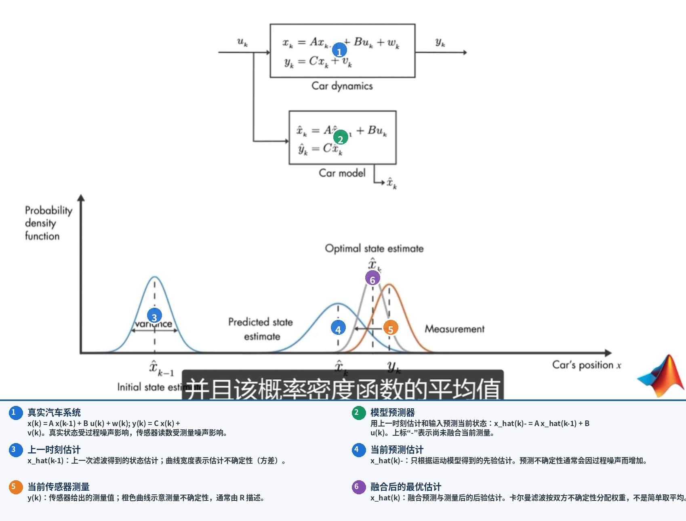

# 卡尔曼滤波图解：预测、测量与融合

> 本笔记对应配图：上半部分是汽车状态模型与预测模型；下半部分是概率分布视角下的“先验预测—传感器测量—后验融合”。

## 1. 先看整张图在讲什么

卡尔曼滤波每个采样时刻大致做两件事：

1. **预测（Predict）**：根据上一时刻的估计、系统模型和控制输入，预测当前状态。
2. **更新（Update）**：拿当前传感器测量来修正预测，得到融合后的状态估计。

因此，图中最重要的顺序是：

$$
\hat{x}_{k-1}\;\xrightarrow{\text{模型预测}}\;\hat{x}_k^-\;\xrightarrow{\text{测量更新}}\;\hat{x}_k
$$

这里的上标“$-$”是“先验/预测”的标记，不是减法。

## 2. 上半部分：真实系统与预测模型

### 2.1 真实汽车系统（标注 1）

图中上方方框写着：

$$
x_k=Ax_{k-1}+Bu_k+w_k
$$

$$
y_k=Cx_k+v_k
$$

含义如下：

| 符号 | 含义 |
|---|---|
| $x_k$ | 当前时刻的真实状态，例如汽车位置、速度组成的向量 |
| $x_{k-1}$ | 上一时刻的真实状态 |
| $u_k$ | 当前控制输入，例如加速度指令 |
| $A$ | 状态转移矩阵，描述状态如何从上一时刻演化到当前时刻 |
| $B$ | 输入矩阵，描述控制输入对状态的影响 |
| $w_k$ | 过程噪声，描述模型未能准确描述的运动扰动 |
| $y_k$ | 当前传感器测量值 |
| $C$ | 观测矩阵，把状态映射到传感器测量空间 |
| $v_k$ | 测量噪声，描述传感器读数的不确定性 |

**直观理解：** 汽车真实运动不可能与理想模型完全一致，所以状态方程中加入过程噪声 $w_k$；传感器也不可能完全准确，所以测量方程中加入测量噪声 $v_k$。

### 2.2 模型预测器（标注 2）

图中下方方框写着：

$$
\hat{x}_k^-=A\hat{x}_{k-1}+Bu_k
$$

$$
\hat{y}_k=C\hat{x}_k^-
$$

预测器使用上一时刻的估计值和当前输入，计算当前状态的预测值。它没有把当前测量 $y_k$ 融合进来，因此这个结果叫**先验估计**或**预测估计**。

真实系统方程中有 $w_k$，而预测器通常不直接加一个未知的随机噪声样本；过程噪声的影响会体现在预测协方差的增加中。

## 3. 下半部分：概率分布曲线怎么看

### 3.1 两条坐标轴

- 横轴：汽车位置 $x$，表示可能的位置值。
- 纵轴：概率密度，表示概率分布在某个位置附近的相对集中程度。

曲线不是汽车行驶轨迹，而是“我们对汽车位置有多确定”的概率描述。曲线中心对应估计均值；曲线越窄，方差越小、不确定性越低；曲线越宽，方差越大、不确定性越高。

### 3.2 左侧蓝色曲线：上一时刻估计（标注 3）

$$
\hat{x}_{k-1}
$$

这是上一时刻滤波结束后得到的估计。图中虚线标出估计均值，旁边的 variance 表示该估计的不确定性大小。

### 3.3 中间蓝色曲线：当前预测估计（标注 4）

$$
\hat{x}_k^-
$$

这是用模型从上一时刻推算到当前时刻的结果。它的均值可能因汽车运动而移动；曲线宽度表示预测不确定性。过程噪声协方差 $Q$ 会影响预测不确定性，通常预测一步后不确定性会增加，但具体变化取决于模型和矩阵数值。

### 3.4 右侧橙色曲线：当前测量（标注 5）

$$
y_k
$$

这是传感器在当前时刻给出的测量。它也有误差，其不确定性通常由测量噪声协方差 $R$ 描述。橙色曲线越窄，表示测量越精确；越宽，表示测量越不精确。

### 3.5 灰色曲线：融合后的最优估计（标注 6）

$$
\hat{x}_k
$$

它是把当前预测估计与当前测量融合后得到的**后验估计**。在图示的一维位置例子里，融合结果通常落在预测均值与测量值之间，并且更偏向不确定性较小（更可信）的一方。

> 注意：图中为了直观，把测量 $y_k$ 也画在汽车位置这一条横轴上。一般模型是 $y_k=Cx_k+v_k$，当 $C$ 不是单位映射时，测量量和状态量不一定处在同一个空间，实际更新要通过观测矩阵 $C$ 处理。

## 4. 用一个数字例子理解“加权融合”

为了直观，先考虑一维情况，且测量直接对应位置（$C=1$）。假设：

- 模型预测位置：$\hat{x}_k^-=12\,\mathrm{m}$；
- 传感器测量位置：$y_k=14\,\mathrm{m}$；
- 卡尔曼增益：$K_k=0.8$。

更新公式为：

$$
\hat{x}_k=\hat{x}_k^-+K_k(y_k-\hat{x}_k^-)
$$

代入：

$$
\hat{x}_k=12+0.8(14-12)=13.6\,\mathrm{m}
$$

结果为 $13.6\,\mathrm{m}$，比预测值更靠近测量值。这是因为此例中的增益 $0.8$ 较大，意味着更新时更重视测量。

- $K_k$ 较大：更重视当前测量；
- $K_k$ 较小：更重视模型预测。

卡尔曼增益不是随意指定的，而是由预测不确定性和测量不确定性计算得到。

## 5. Q 和 R 分别影响什么？

| 符号 | 名称 | 表示什么 | 变大时通常意味着 |
|---|---|---|---|
| $Q$ | 过程噪声协方差 | 对运动模型不确定性的描述 | 更不相信模型预测，更新时通常更重视测量 |
| $R$ | 测量噪声协方差 | 对传感器测量不确定性的描述 | 更不相信传感器，更新时通常更重视模型预测 |

这里的“更重视”是对卡尔曼更新权重的直观描述，具体影响还取决于系统矩阵、观测矩阵和协方差传播。

## 6. 对应的标准卡尔曼滤波公式

### 6.1 预测步骤

状态预测：

$$
\hat{x}_k^-=A\hat{x}_{k-1}+Bu_k
$$

协方差预测：

$$
P_k^-=AP_{k-1}A^T+Q
$$

其中 $P_{k-1}$ 表示上一时刻状态估计误差的协方差，$P_k^-$ 表示预测误差协方差。

### 6.2 更新步骤

卡尔曼增益：

$$
K_k=P_k^-C^T(CP_k^-C^T+R)^{-1}
$$

状态更新：

$$
\hat{x}_k=\hat{x}_k^-+K_k(y_k-C\hat{x}_k^-)
$$

协方差更新（常见形式）：

$$
P_k=(I-K_kC)P_k^-
$$

这几条公式说明：卡尔曼滤波不仅更新状态估计，也同时更新对估计不确定性的判断。

## 7. 一句话总结整张图

**先用运动模型预测汽车在哪里，再用传感器测量修正预测；模型和传感器谁更可靠，就在融合时给谁更大的权重，最终得到当前状态的后验估计 $\hat{x}_k$。**
